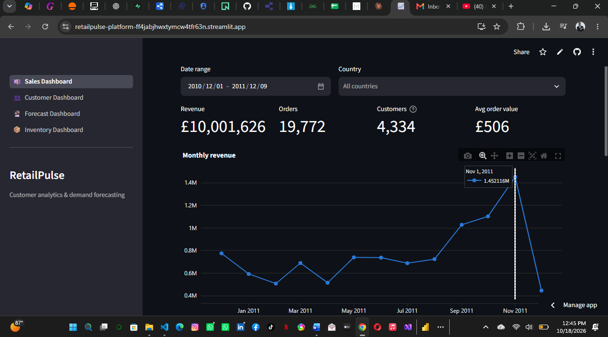
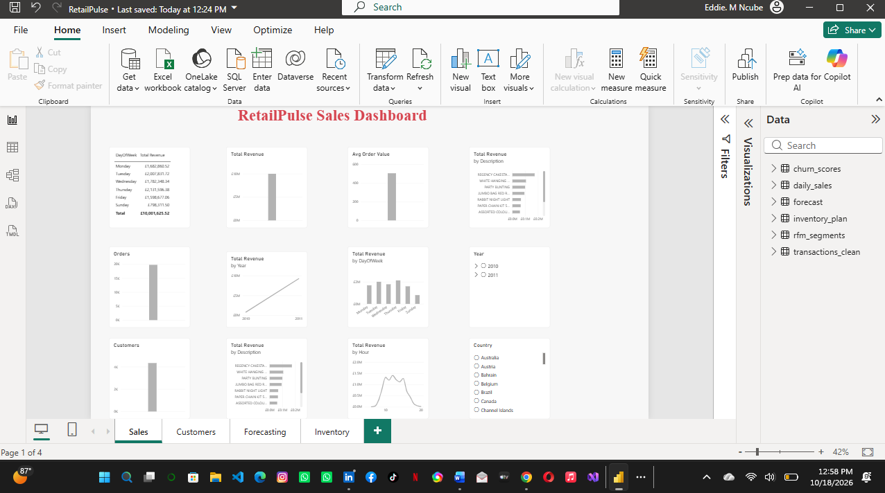
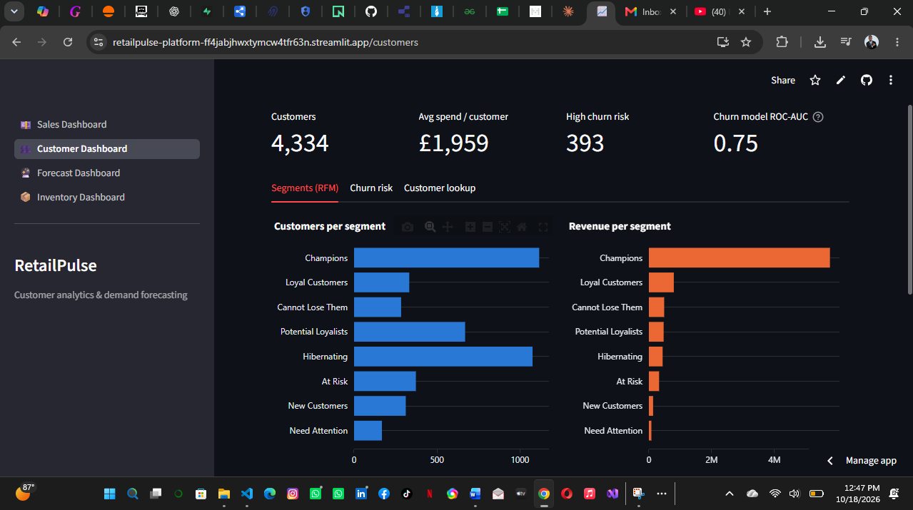
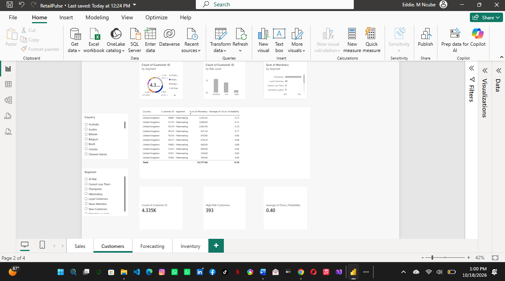
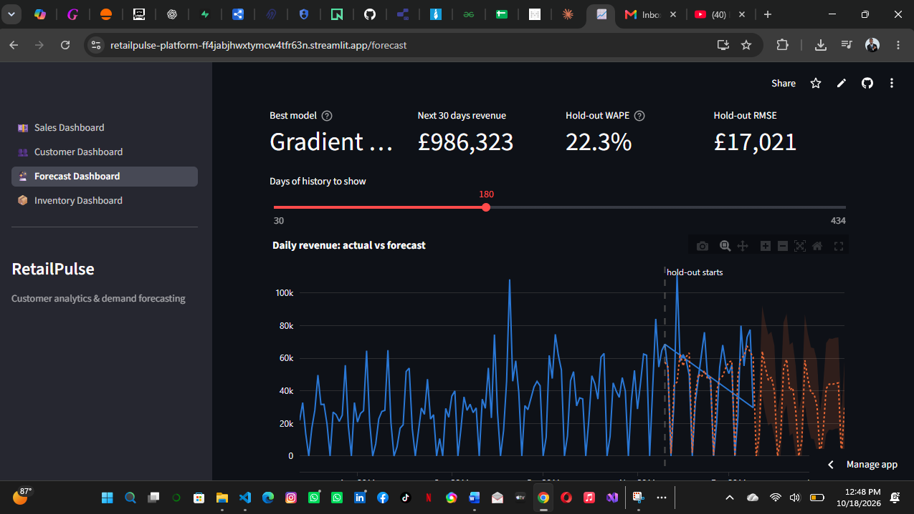
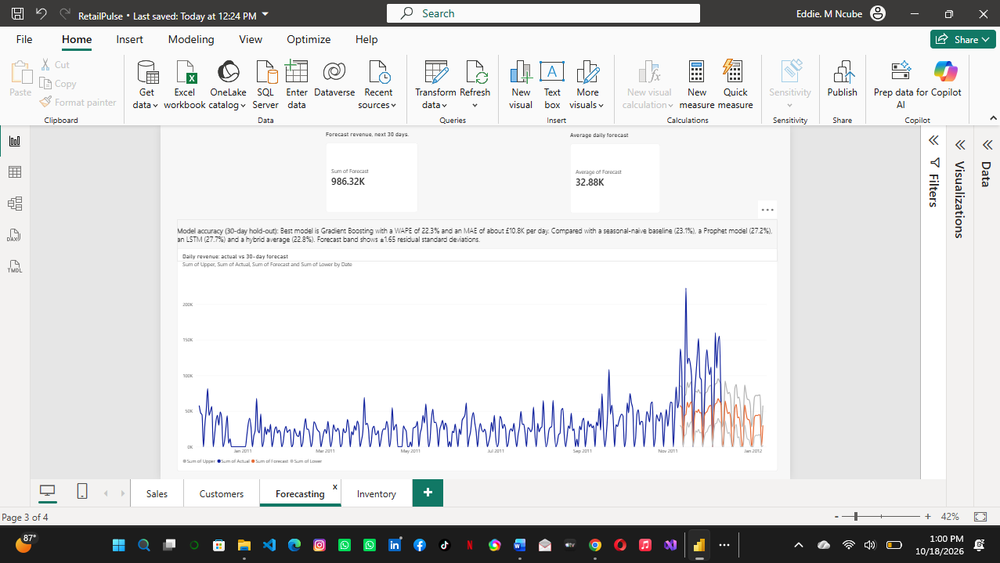
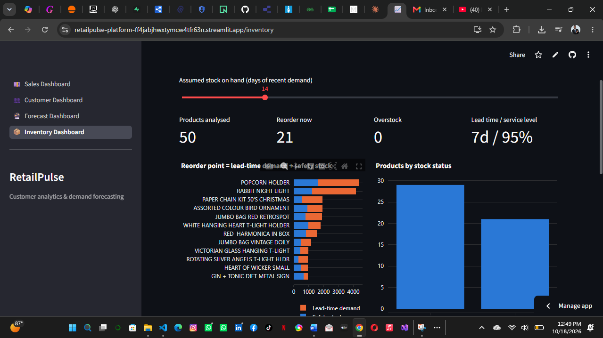
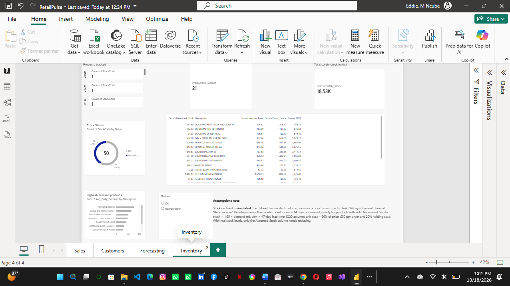

# RetailPulse

**AI-Powered Customer Analytics & Demand Forecasting** — Zidio Internship Project

RetailPulse turns the Online Retail II transactions (UCI / Kaggle) into sales insight, customer segments, a churn score, a 30-day revenue forecast and an inventory plan. One command runs the whole pipeline, and the results feed a live Streamlit app and a four-page Power BI report.

| Deliverable | Link |
|---|---|
| Live app (Streamlit Community Cloud) | https://retailpulse-platform-ff4jabjhwxtymcw4tfr63n.streamlit.app/ |
| Power BI report | [`RetailPulse.pbix`](RetailPulse.pbix) (open in Power BI Desktop) |
| Demo video | https://drive.google.com/file/d/1AD4fGuuv-CHZxY6O7E5Y1ErSbKRrriUa/view?usp=sharing |
| Feedback video | https://drive.google.com/file/d/1PxNxvLAGEmt8h6CaJU7KFTqUrWF9vEA5/view?usp=sharing |
   | Project report (PDF) | [docs/RetailPulse_Report.pdf](docs/RetailPulse_Report.pdf) |
   

## Results at a glance

| Area | Result |
|---|---|
| Customers | 4,334 customers segmented with RFM scoring and K-Means |
| Churn | 393 customers flagged high risk. Best model: Gradient Boosting (Optuna-tuned), ROC-AUC 0.75 |
| Forecast | Best model: Gradient Boosting, WAPE 22.3% on a 30-day hold-out. About £986K forecast for the next 30 days |
| Inventory | Safety stock, reorder point and EOQ for the top 50 products (stock on hand is assumed, see limitations) |

The forecast beats a seasonal-naive baseline (WAPE 23.1%) only slightly. With one year of daily data, the weekly pattern is the main thing any model can learn.

## Screenshots

| Streamlit app | Power BI report |
|---|---|
|  |  |
|  |  |
|  |  |
|  |  |

## Workflow

The pipeline follows the 12-step project procedure. Steps 1–10 run with one command, `run_pipeline.py`.

| # | Step | Code |
|---|---|---|
| 1–3 | Collect, import, load (plus the custom row) | `src/data_loader.py` |
| 4 | Data cleaning | `src/cleaning.py` |
| 5 | Feature engineering | `src/features.py` |
| 6 | EDA | `src/eda.py` |
| 7 | Customer segmentation (RFM + K-Means) | `src/rfm.py` |
| 8 | Demand forecasting (seasonal baseline, gradient boosting, Prophet, LSTM, hybrid) | `src/forecasting.py` |
| 9 | Churn prediction (with Optuna tuning) | `src/churn.py` |
| 10 | Inventory optimisation | `src/inventory.py` |
| 11 | Dashboards | `app/` (Streamlit), `RetailPulse.pbix` (Power BI) |
| 12 | Deployment | Streamlit Community Cloud |

Also included: a drift check using the population stability index (`src/drift.py`) and MLflow experiment tracking. An Airflow DAG (`dags/retailpulse_dag.py`) and a `Dockerfile` are written but were not run or built for this submission.

## The custom row

The brief asks for the data not to be used exactly as downloaded. `src/config.py` defines one extra transaction, appended at load time and flagged `is_custom_row=True`, so it can be traced through every stage.

| Field | Value |
|---|---|
| Invoice | 999001 |
| Stock code | RP-0001 |
| Description | RETAILPULSE CUSTOM GIFT SET |
| Quantity | 12 |
| Unit price | £4.95 |
| Invoice date | 2011-12-09 12:30 |
| Customer ID | 99999 |
| Country | United Kingdom |

## Quick start (Windows, PowerShell)

Use Python 3.12. TensorFlow does not install on Python 3.14.

```powershell
py -3.12 -m venv .venv
.venv\Scripts\Activate.ps1
python -m pip install -r requirements.txt

# Get the data: download Online Retail II from Kaggle and put the file in data/raw/
# https://www.kaggle.com/datasets/cgrymn/online-retail-ii-uci-dataset

python run_pipeline.py --years 2010-2011      # steps 1-10
streamlit run app/streamlit_app.py            # open the dashboard locally
```

Other options: `--years both`, `--path <file>`, `--no-mlflow`, `--optuna-trials N`. `--sample` runs on synthetic data to test the setup only. The raw data file is not stored in this repository.

To view experiment tracking: `mlflow ui --backend-store-uri sqlite:///outputs/mlflow.db`

## Dashboards

**Streamlit app** (`app/streamlit_app.py`, pages in `app/views/`)

| Page | Contents |
|---|---|
| Sales | Revenue, orders, customers and average order value; monthly trend; top products and countries; day and hour patterns; date and country filters |
| Customers | RFM segments, churn-risk distribution and drivers, high-risk watchlist (downloadable), customer lookup |
| Forecast | Actual versus forecast with a prediction band, model comparison table, downloadable 30-day forecast |
| Inventory | Reorder point, stock status and the full plan for the top 50 products, with an adjustable assumed-stock slider |

**Power BI report** (`RetailPulse.pbix`) has four pages: Sales, Customers, Forecasting and Inventory. It reads the CSV files that `run_pipeline.py` writes to `outputs/powerbi/`.

## Models

- **Segmentation:** quintile RFM scores mapped to named segments, plus K-Means on log-scaled RFM with *k* chosen by silhouette score.
- **Forecasting:** seasonal-naive baseline, gradient boosting on lag and calendar features, Prophet, LSTM and a hybrid average. The model with the lowest WAPE on a 30-day hold-out produces the forecast.
- **Churn:** a customer churns if they make no purchase in the 90 days after a cut-off date. Features use only data before the cut-off, so there is no leakage. Logistic regression, random forest, gradient boosting and an Optuna-tuned gradient boosting are compared by ROC-AUC. Recency is tightly linked to this churn definition, so its importance should be read with care.
- **Inventory:** safety stock = z × σ × √lead time (z = 1.65, 7-day lead time); reorder point = demand over lead time + safety stock; EOQ from order and holding cost. Parameters are in `src/config.py`.

## Limitations

- **Stock on hand is assumed.** The dataset has no stock column, so every product is assumed to hold 14 days of recent demand (adjustable in the Streamlit app). Safety stock, reorder point and EOQ come from real sales, but the stock status is illustrative. EOQ also assumes a unit cost of 60% of price, £50 per order and a 20% holding cost.
- **One year of data** limits the forecast, so it cannot learn yearly seasonality beyond a single Christmas peak.
- **Churn definition** (no purchase in 90 days) is a modelling choice that suits this retailer.
- Rows without a customer ID are counted in sales totals but excluded from customer analysis.

## Deployment

The app is deployed on Streamlit Community Cloud with `app/streamlit_app.py` as the entry point and Python 3.12. It installs the light `app/requirements.txt` (no TensorFlow or Prophet), and the Sales page loads only the columns it needs to stay inside the free-tier memory limit. The saved files in `outputs/` are committed because the app reads them. The root `requirements.txt` is the full set for running the pipeline locally.

## Project structure

```
Retailpulse_Platform/
├── run_pipeline.py          # steps 1-10
├── src/                     # loader, cleaning, features, eda, rfm, forecasting, churn, inventory, drift
├── app/                     # Streamlit app (entry: streamlit_app.py, pages in views/)
├── RetailPulse.pbix         # Power BI report
├── screenshots/             # dashboard screenshots
├── dags/                    # Airflow DAG (not run)
├── tests/                   # pytest (5 tests)
├── data/raw/                # put the Kaggle file here (not committed)
├── outputs/                 # generated: parquet, json, charts, powerbi CSVs
├── Dockerfile               # written, not built
├── requirements.txt         # full pipeline dependencies
└── app/requirements.txt     # light dependencies for the cloud app
```

## Tests

```powershell
pytest -q
```
